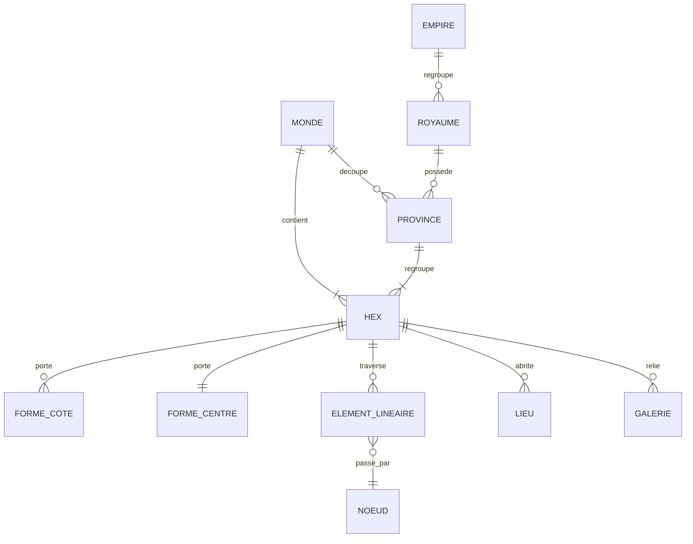

# Spécification — Éditeur de carte hexagonal (Édition 8)

Version 0.1 — 24 octobre 2026. Statut : projet de spécification, à débattre avec Francky avant gel. L'éditeur est un outil du MdM pour initialiser sa partie ; il produit la source de vérité unique du monde, consommée par le moteur, le portail et les applications. Ce document ne couvre pas l'application joueur, qui lit la même carte en lecture filtrée (brouillard de guerre).

## 1. Rappel des arbitrages structurants

- Grille d'hexagones réguliers collés par leurs côtés (adjacence par les six côtés, jamais par les sommets seuls).
- Couches de contenu : niveau 0 (terrain de base), niveau 1 (reliefs remarquables et éléments linéaires), niveau 2 (lieux remarquables), niveau -1 (sous-sol : galeries, mines, eaux souterraines).
- Les déplacements (sol, eau, air, souterrain) ne sont pas des couches de données mais des modes de traversée dérivés des couches de contenu ; l'éditeur ne peint jamais un déplacement.
- Éléments linéaires : polylignes sur les nœuds de la géométrie — centres de région, milieux d'arête, sommets. Le passage par le centre n'est qu'un cas particulier ; un élément peut longer des arêtes par les sommets, traverser d'arête à arête, ou couper par un sommet. Un élément ne se termine jamais au centre d'une région de mer.
- La table unique d'effets de terrain (six formes de côté + forme de centre, indexée par forme et saison) reste dédiée au relief ; les éléments linéaires forment une couche de données indépendante.
- Formes de terrain : génération hybride (par lots à la création, puis à la demande par l'agent IA), formes gelées après validation, cinq à sept formes par famille, 40 à 60 formes au catalogue.
- Carte de test visée : 150 hexagones et plus, au moins deux climats, au moins une mer.

## 2. Modèle de données produit par l'éditeur

### Entités principales

- Monde : dimensions de la grille, nom, options climatiques. Une fois créé, les dimensions ne peuvent que s'étendre, jamais se réduire.
- Hex (région) : coordonnées (colonne, rangée), terrain de base (niveau 0), liens vers ses formes, ses éléments linéaires, ses lieux, ses galeries. Dans le vocabulaire du jeu, l'hexagone porte le nom de région ; le terme hexagone (hex) reste d'usage technique dans l'éditeur et le moteur.
- Forme de côté (six par hex) : référence au catalogue des formes, partagée avec l'hex voisin (une modification s'applique aux deux hex).
- Forme de centre (une par hex) : référence au catalogue.
- Élément linéaire : type (rivière, fleuve, route, chemin, canal…), polyligne définie sur les nœuds de la géométrie hexagonale — centres de région, milieux d'arête (côtés partagés), sommets. Chaque tronçon relie deux nœuds adjacents : centre—arête, arête—sommet, arête—centre voisin, centre—sommet, sommet—arêtes voisines, sommet—centres voisins. Le passage par le centre d'une région n'est qu'un cas particulier : un élément peut traverser une région d'arête à arête, longer des frontières en passant par les sommets, ou couper par un sommet. Un élément ne se termine jamais au centre d'une région de mer : il s'arrête sur l'arête ou le sommet côtier.
- Lieux (niveau 2) : chaque lieu remarquable occupe une région entière et se positionne au centre de celle-ci. Une ville est une entité multi-régions dont l'emprise dépend de son niveau (0 à 12, jusqu'à 12 pour les cités exceptionnelles) : niveaux 0 à 2 — une région (Relais, Hameau, Bourg) ; niveaux 3 à 6 — trois régions (Bourgade, Petit Village, Village, Village Fortifié) ; niveaux 7 à 9 — quatre régions (Ville, Cité, Cité de Province) ; niveaux 10 à 12 — sept régions (Cité de Royaume, Megapole, Megapole Impériale). L'emprise est symétrique et centrée : une région (centre sur la région), trois régions (triangle centré sur le sommet commun), quatre régions (losange centré sur l'arête commune), sept régions (fleur centrée sur la région centrale). L'éditeur génère l'emprise autour d'une région de départ selon le niveau ; le MdM peut refuser ou réorienter la proposition. Chaque région de l'emprise peut recevoir son propre lieu remarquable centré (quartier, temple, forteresse interne).
- Galerie (niveau -1) : réseau tracé entre points d'entrée, jamais une seconde grille complète peinte d'avance.
- Franchissement : nature (pont, gué, rien), position au croisement d'un élément de liaison et d'un cours d'eau, références aux deux éléments croisés.
- Province : ensemble contigu d'hexagones, nom, capitale de province, villes.
- Royaume : ensemble de provinces, nom, capitale de royaume, régime administratif (administré, nomade…) — utilisé par la diffusion des traités (arbitrage D3).
- Empire : ensemble de royaumes, nom, capitale impériale ; un royaume appartient à au plus un empire ; l'empire peut être non contigu.

## 3. Écrans et outils de l'éditeur

### Écran 1 — Initialisation du monde

Créer la grille : dimensions, forme du monde (rectangle, continent, archipel), climat de référence. Génération par lots des formes de terrain des hex stratégiques (capitales, frontières, défilés, provinces de départ). Le MdM peut relancer un lot ou demander une variante à l'agent IA ; toute forme validée est gelée.

### Écran 2 — Peinture du terrain (niveau 0 et formes)

- Palette de terrains de base : plaine, colline, montagne, forêt, mer, désert, marais…
- Pinceau simple, pinceau zone (remplissage d'une sélection), pipette.
- Peinture des formes de côté : sélection d'un hex, choix d'un côté parmi six, affectation d'une forme du catalogue ; le côté étant partagé, l'opération porte sur l'arête.
- Indicateur de gel : les formes déjà validées affichent un verrou ; déverrouiller exige une trace explicite (journal de modification).

### Écran 3 — Éléments linéaires (niveau 1)

- Choix du type d'élément (rivière, fleuve, route, chemin, canal).
- Tracé en désignant une séquence d'hexagones : l'outil calcule côté d'entrée, passage au centre, côté de sortie ; le MdM peut forcer un côté d'entrée ou de sortie manuellement.
- Tracé direct : le MdM désigne une région d'origine et une région d'arrivée, même éloignées ou séparées par une ligne de régions ; l'outil calcule automatiquement un chemin contigu (par adjacence des côtés) traversant les régions intermédiaires, que le MdM peut ensuite ajuster avant validation. Le mode hex par hex reste disponible pour les méandres volontaires.
- Jonctions et embranchements autorisés : chaque tronçon conserve son propre couple entrée/sortie.
- Trait de côte : un élément linéaire aboutissant dans une région de mer s'arrête sur l'arête ou le sommet côtier, jamais au centre de la région de mer. L'estuaire visuel se situe donc sur le trait de côte.
- Placement des points de franchissement : pont, gué, passe — attachés à une arête ou au centre. Franchissements de cours d'eau : lorsqu'un élément de liaison (route, chemin) croise un cours d'eau (rivière, fleuve, canal), ou inversement, l'éditeur détecte chaque croisement et demande l'arbitrage du MdM pour chacun : pont, gué, ou rien (traversée à gué impossible ou non aménagée). Le franchissement est une entité de données à part entière (nature, position, éléments concernés) ; la gomme le retire indépendamment des deux éléments.

### Écran 4 — Reliefs et lieux remarquables (niveaux 1 et 2)

- Palette de reliefs : volcan, cascade, entrée de mine, lac, étang — contenu de l'hex.
- Palette de lieux : villes posées par niveau (l'emprise 1, 3, 4 ou 7 régions est générée selon le niveau), puis château, tour, ruine, mine, sanctuaire — chacun occupant une région et centré sur elle ; nommage à la pose.
- Fiche de lieu : attributions futures (garnison, production) laissées volontairement hors périmètre de la v0.1.

### Écran 5 — Provinces, royaumes et empires

Hiérarchie arbitrée : une province est un ensemble contigu d'hexagones ; un royaume est un ensemble de provinces ; un empire est un ensemble de royaumes.

- Mode province : peinture d'un ensemble contigu d'hexagones, contrôle automatique de contiguïté ; nommage, désignation de la capitale de province.
- Mode royaume : regroupement de provinces, capitale de royaume, régime administratif (utilisé par la diffusion des traités, arbitrage D3).
- Mode empire : regroupement de royaumes ; un royaume peut appartenir à au plus un empire ; la dissolution d'un empire libère les royaumes sans les supprimer.
- Contiguïté arbitrée : les provinces sont contiguës (contrôlé automatiquement) ; les royaumes ne le sont pas nécessairement — une province peut faire sécession, être conquise, un royaume peut détenir des enclaves. L'éditeur ne contrôle donc pas la contiguïté au niveau royaume, mais signale les royaumes morcelés à titre informatif.
- Affichage des noms : le nom de chaque province figure sur la carte, au centre de gravité de ses régions, avec un contour de lisibilité ; les noms de royaumes et d'empires sont consultables dans les listes de l'éditeur (affichage cartographique à arbitrer lors du design de l'habillage).
- Suppression et correction d'erreur : suppression d'une province (ses régions redeviennent libres), d'un royaume (ses provinces redeviennent libres), d'un empire (ses royaumes redeviennent libres) ; la suppression d'un niveau ne supprime jamais les niveaux inférieurs, et toute suppression est tracée au journal.
- Contrôles : chaque hex doit appartenir à au plus une province ; chaque province à au plus un royaume ; chaque royaume à au plus un empire ; la province principale doit abriter la capitale de royaume.

### Écran 6 — Sous-sol (niveau -1)

- Tracé de galeries entre points d'entrée (entrées de mine, puits) : désigner deux points, l'outil propose le chemin le plus court ; le MdM peut l'ajuster.
- Affectation d'un type de tronçon (galerie, mine exploitée, rivière souterraine) et d'un état (ouvert, effondré, inconnu des joueurs).

### Écran transverse — Journal et gel

- Toute création ou modification est tracée : auteur, date, nature de l'opération, avant/après.
- Génération des formes par l'agent IA : la composition hors catalogue requiert une validation explicite du MdM ; toute forme produite est gelée après validation.

## 4. Contrôles de cohérence automatiques

1. Un élément linéaire qui sort d'un hex par un côté doit entrer dans l'hex voisin par ce même côté (raccord automatique, aucune orpheline tolérée).
2. Un cours d'eau doit se terminer en mer, en lac ou en source (terme de type source/marais), jamais en plein champ.
3. Une province est contiguë ; aucune enclave non déclarée.
4. Une capitale de province est un lieu de type ville dans un hex de la province.
5. Une capitale de royaume est dans la province principale du royaume.
6. Un royaume appartient à au plus un empire ; un royaume peut être non contigu (sécession, conquête, enclaves) : aucun blocage, signalement informatif seulement.
7. Chaque région abrite au plus un lieu remarquable, centré sur elle ; une ville de niveaux 3 et plus s'étend sur 3, 4 ou 7 régions contiguës et symétriques, générées autour de la région de départ.
8. Aucune forme modifiée après gel sans trace au journal.
9. Un lieu de niveau 2 ne peut être posé sur un hex de mer (hors port et phare, à arbitrer).

## 5. Sorties et consommations

- Export JSON de la carte (format unique, versionné, consommé par le moteur).
- Deux modes de rendu consommant la même source : (1) rendu symbolique à plat — aplats de couleur, variations de teinte et symboles — utilisé en création et en arbitrage, pour la lisibilité et la rapidité ; (2) rendu final isométrique — le système génère une carte mise en valeur avec relief en hauteur, textures détaillées (forêts, montagnes, eaux), dérivée des données de terrain (un gradient de hauteur par famille : plaine, colline, montagne, haute montagne, très haute montagne). Le rendu isométrique est une vue, jamais une source de vérité : la hauteur est calculée depuis les terrains, jamais saisie à la main.
- Diff applicative : toute modification après le début d'une partie doit être publiée comme delta horodaté, sans réécriture de l'historique des parties jouées.
- Le même export alimente : le moteur de résolution, l'application DM (mode création et mode arbitrage), l'application joueur (rendu filtré par brouillard de guerre — filtrage effectué côté serveur, jamais côté client).

## 6. Hors périmètre de la v0.1 (volontairement exclu)

- Rendu adaptatif des textures de terrain (transitions automatiques entre hex adjacents) : postposé à une itération ultérieure, car coûteux et sans effet sur les règles.
- Coûts de déplacement et tables de franchissement : chantier Déplacement.
- Valeurs chiffrées des productions par hex : chantier Pays et provinces.
- Multijoueur et verrouillage concurrent : l'éditeur est mono-utilisateur (le MdM).

## 7. Prototype jetable associé

